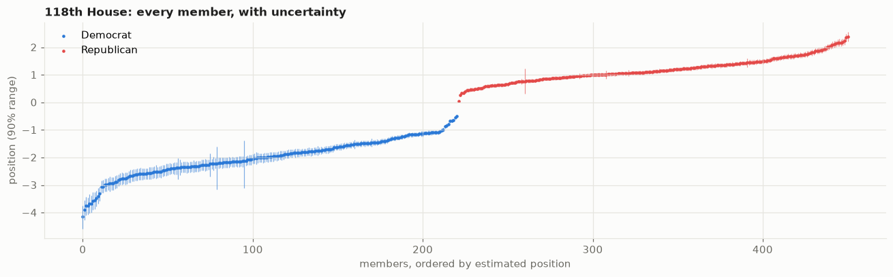
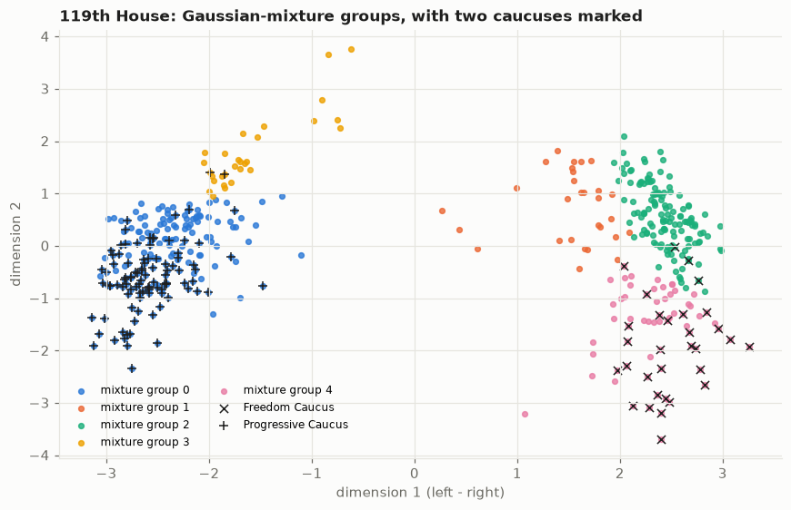
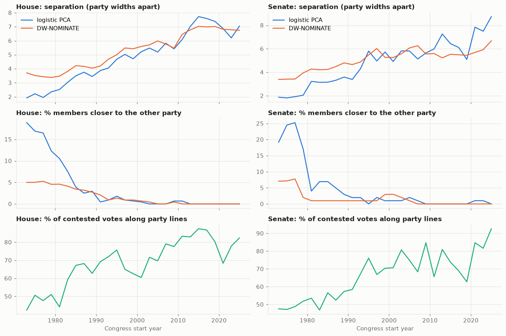

# ideology-clusters

**Can you find the political factions in Congress just from how members vote, and which methods find
them best?**

Every recorded vote in the House and Senate is public. Lay them out as a giant table (one row per member,
one column per vote, yes or no in each cell) and patterns appear: members who vote alike end up close
together. This project goes past the usual tutorial ("run k-means, the two parties separate"):

- **Placing members on a map:** PCA, logistic PCA, and a Bayesian ideal-point model that gives every
  member a position **with an error bar**.
- **Finding factions:** five clustering methods compared, beyond k-means.
- **Checked against known answers:** a synthetic Congress where we set every member's position;
  DW-NOMINATE, political science's standard scores; and caucus membership the votes never saw.
- **Polarisation since 1973**, from 54 House and Senate sessions.

Write-up for general readers: [blog.md](blog.md). Interactive explorer (hover any member, highlight a
caucus, search by name): [docs/explorer.html](docs/explorer.html), a single self-contained file; download and open it.

| Notebook | Question |
|---|---|
| [1 · Positions](notebooks/01_positions.ipynb) | Which method places members best, and how sure can we be? |
| [2 · Clusters](notebooks/02_clusters.ipynb) | Are there factions inside the parties? |
| [3 · Polarisation](notebooks/03_polarization.ipynb) | How far apart have the parties moved since 1973? |

## The trap: "it separates the parties" proves little

Any method splits Democrats from Republicans: simple PCA on the 118th House matches DW-NOMINATE at a
correlation of **0.97**. Within each party the agreement drops to 0.52 (Democrats) and 0.82
(Republicans). Ordering members *within* their own party is the real test, and every method here is
scored on it.

## 1 · Positions

**On a synthetic Congress with known positions** (440 members, six factions, noisy votes, non-random
absences), ranking members within their party:

| Method | Within-party rank correlation (D / R) | 2-D map recovered (1 = exact) |
|---|---|---|
| PCA | 0.88 / 0.90 | 0.61 |
| **Logistic PCA** | **0.99 / 0.99** | **0.95** |

PCA fills each missed vote with an average, which drags absentees toward the middle; logistic PCA
models the chance of a "yes" and simply skips missed votes.

**On real votes (118th House)**, hiding 10% of votes and predicting them:

| Predictor | Hidden votes right |
|---|---|
| "Vote with your party's majority" | 92.8% |
| Logistic PCA, 1 dimension | 95.5% |
| Logistic PCA, 2 / 3 dimensions | 96.1% / 96.3% |

One left-right dimension does most of the work, as decades of political science have found.

**The Bayesian ideal-point model** (Clinton, Jackman & Rivers 2004, in NumPyro) agrees best with
DW-NOMINATE within party: **0.90** among Republicans and **0.72** among Democrats in the 118th House
(0.89 / 0.75 in the 119th), against 0.75 / 0.67 for logistic PCA. Its error bars are honest where the
model fits. On the synthetic Congress its 90% ranges contain the truth 77-91% of the time for five
factions, but only **25%** for the faction that differs on a *second* dimension: a one-dimensional model
is confidently wrong about them. **Give the model a second dimension and that faction's coverage rises to
93%** (95% on dimension 2), with the other five at 82-97% on both.

| Faction (synthetic) | 1-D model | 2-D model, dim 1 | 2-D model, dim 2 |
|---|---|---|---|
| Hard-line (differs on dim 2) | **25%** | **93%** | 95% |
| Other five factions | 77-91% | 87-97% | 82-94% |



## 2 · Clusters

Each method picks its own number of groups. On the synthetic Congress, k-means, a Gaussian mixture and
Ward clustering all find **Democrats, Republicans and the faction that votes differently in kind**.
Factions that differ only by degree form a continuum with no gap to find; forcing k-means to make the
"right" 6 groups scores *worse*.

**On the 119th House**, checked against caucus membership (Wikipedia's current lists, retrieved
2026-10-17; the Freedom Caucus doesn't publish its roster, so its list is publicly identified members).
F1 = how well one cluster captures that caucus within its party (1 = exactly); stability = how much the
clustering stays the same when the roll calls are resampled (median ARI, 1 = identical):

| Method | Groups | Freedom Caucus | Progressive Caucus | Blue Dogs | Stability |
|---|---|---|---|---|---|
| k-means | 3 | 0.55 | 0.63 | 0.63 | 0.95 |
| Gaussian mixture | 5 | 0.59 | 0.66 | 0.31 | 0.75 |
| HDBSCAN | 2 | 0.24 | 0.62 | 0.05 | 0.97 |
| Ward | 3 | **0.70** | 0.61 | 0.09 | 0.87 |
| Network communities | 5 | 0.61 | **0.82** | 0.15 | 0.68 |

**The methods that find the most faction structure are the least stable.** No single best method:
report clusters with their stability, and use soft membership (the mixture's) for members between groups.



**What the second dimension is.** Among Republicans, left-right barely predicts who breaks with the party
(correlation 0.07 across the 133 votes with at least 5% dissent); dimension 2 does (0.36, and 0.61 on
bipartisan "suspension" bills). In both parties, dimension 2 tracks how often a member votes yes on the
80 bills that both parties' majorities supported (rank correlation 0.88 in each). The Freedom Caucus's
median member voted yes on 53% of them, other Republicans 99%; Progressives 88%, other Democrats 97%.
The positions come from these same votes, so this describes the axis; the caucus comparison is the
independent check. (`scripts/dimension2.py`)

**2-D Bayesian fit on the 119th House** (`scripts/fit_irt2d.py`): error bars on both dimensions. 30 of
31 Freedom Caucus members have a dimension-2 90% range entirely below the median other Republican (a
third of other Republicans do); their dimension-2 ranges are half as wide (0.24 vs 0.49). Among
Republicans, the 1-D scale and DW-NOMINATE dim 1 track the bipartisan yes-rate (rank correlation -0.85 /
-0.76); the 2-D model's dim 1 barely does (-0.16) and agrees less with DW-NOMINATE (0.54 vs 0.89 for the
1-D model). The median Freedom Caucus member goes from the 93rd percentile of Republicans (1-D) to the
66th (2-D dim 1). The split between the two axes depends on the rotation (aligned to logistic PCA).

## 3 · Polarisation

Gap between the party medians, in "typical party widths", per Congress, from our model and from
DW-NOMINATE (correlation between the two series: 0.98 House, 0.89 Senate):

| | 1973 | 1993 | 2013 | 2025 |
|---|---|---|---|---|
| House, logistic PCA | 1.9 | 4.1 | 7.0 | 7.1 |
| House, DW-NOMINATE | 3.7 | 4.7 | 6.8 | 6.8 |

Since the early 2000s essentially no member sits closer to the other party's median. In the 1970s the
two models disagree on how much overlap there was (about 1 in 5 vs 1 in 15-20): that era's cross-party
voting ran partly along a second dimension.



## Method notes (honesty)

- **DW-NOMINATE is a comparison, not ground truth** within a party: it pools each member's whole career
  and uses a different voting model. The synthetic Congress is the answer key.
- Model settings were picked by predicting hidden votes, never by matching DW-NOMINATE.
- The Bayesian sampler (NUTS, no divergences): 118th House and Senate, 1 chain, 500 + 500 draws, split
  R-hat 1.02 / 1.03, effective sample size low (~18) for a few members, so their intervals are rougher.
  119th House: 2 chains, 1000 + 1000 draws, R-hat 1.02, min ESS 67 (a first 1-chain run mixed poorly).
  119th House 2-D: 2 chains, 1000 + 500 draws, R-hat 1.04 after alignment (2.3 raw), min ESS 23 for one
  member; Freedom Caucus members' ESS is at least 172 (dim 2) and 368 (dim 1).
- The model pins the axis's location, scale and (in 2-D) rotation only weakly, so chains drift in ways
  that move nobody relative to anyone else. Synthetic draws are standardised (1-D) or rotated onto the
  logistic-PCA map (2-D) before scoring; after that, R-hat is 1.01 (1-D) and 1.02 (2-D).
- Voteview's vote files also record the President's announced positions as a "member"; they are
  excluded (found during this project).
- These are public officials' public votes, reported with the methods' own neutral terms.

## Run

```bash
python3 -m venv .venv && source .venv/bin/activate
pip install -r requirements.txt -r requirements-dev.txt && pip install -e .
pytest -q
python scripts/run_analysis.py              # all non-Bayesian results (~10 min, downloads Voteview data)
python scripts/fit_irt.py 118S 118H 119H    # Bayesian ideal points (~5-15 min each, CPU)
python scripts/fit_irt_synthetic.py         # 1-D vs 2-D Bayesian model on the synthetic Congress (~40 min)
python scripts/dimension2.py                # what dimension 2 means (needs run_analysis first)
python scripts/fit_irt2d.py                 # 2-D Bayesian model on the 119th House (~15 min; needs dimension2)
python scripts/build_explorer.py            # docs/explorer.html, the interactive page
python notebooks/build.py                   # then execute each notebook (see notebooks/build.py)
```

## References

- Clinton, J., Jackman, S., & Rivers, D. (2004). The Statistical Analysis of Roll Call Data.
  *American Political Science Review*, 98(2), 355-370. https://doi.org/10.1017/S0003055404001194
- Poole, K. T., & Rosenthal, H. (1985). A Spatial Model for Legislative Roll Call Analysis.
  *American Journal of Political Science*, 29(2), 357-384.
- Poole, K. T., & Rosenthal, H. (1997). *Congress: A Political-Economic History of Roll Call Voting*.
  Oxford University Press.

## Data

Lewis, Jeffrey B., Keith Poole, Howard Rosenthal, Adam Boche, Aaron Rudkin, and Luke Sonnet.
*Voteview: Congressional Roll-Call Votes Database.* https://voteview.com/. Downloaded at runtime, not
redistributed. Caucus lists: English Wikipedia (CC BY-SA), fetched at runtime.
